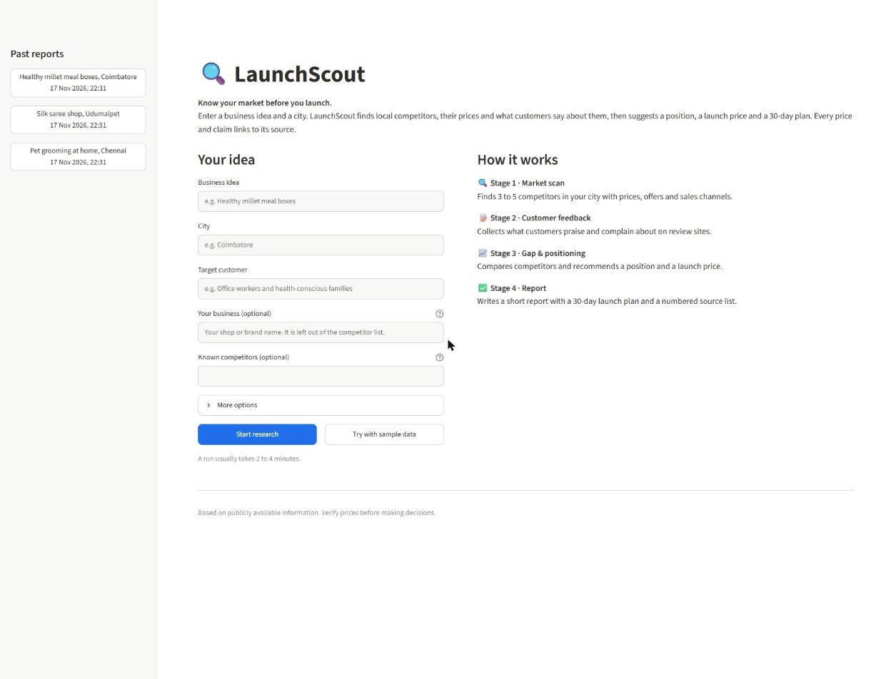
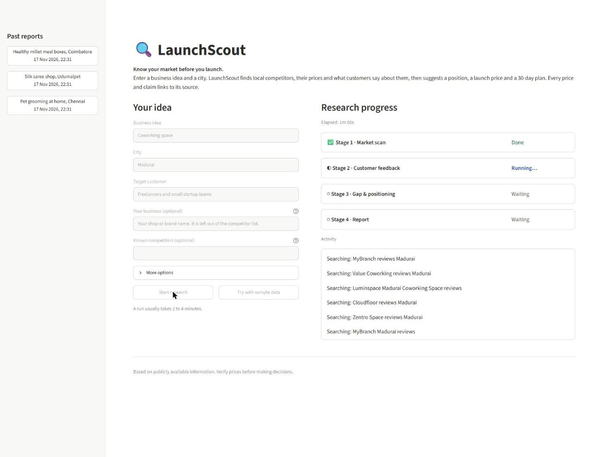
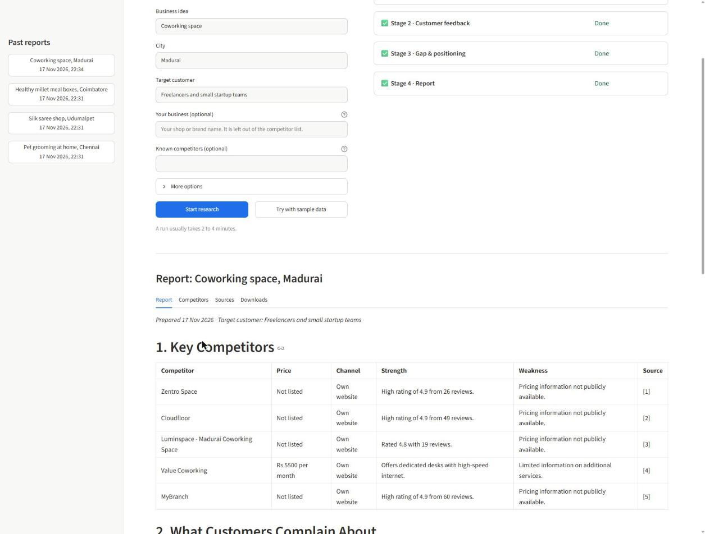
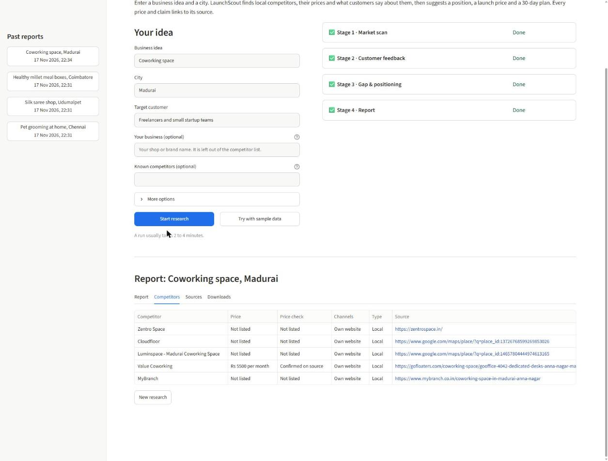
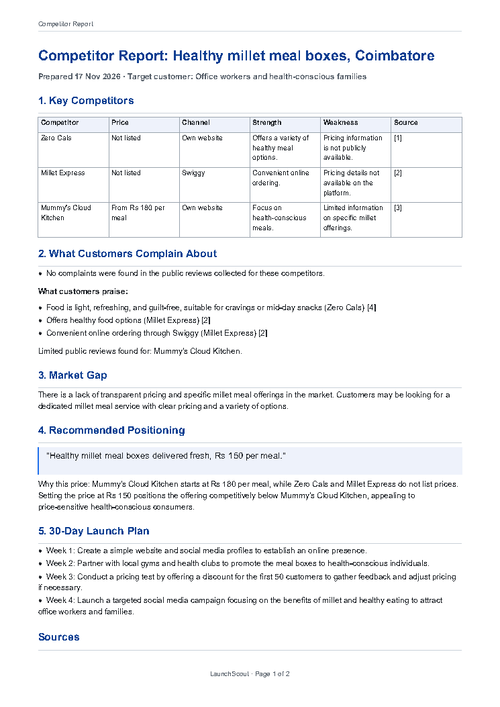

# LaunchScout

[](https://github.com/pdineshkumar55/launchscout/actions/workflows/ci.yml)

**Competitor research report for any business idea and city, with prices and sources.**

Type a business idea and a city. In 1 to 3 minutes LaunchScout finds local competitors, their prices and
what customers say about them, then recommends a position, a launch price and a 30-day plan. Every price
and claim links to its source. Download the report as Markdown or PDF.

Live: https://launchscout.dinesh-genai.tech



## Features

- **Any idea, any city.** No code changes between "millet meal boxes, Coimbatore" and "coworking space, Madurai".
- **Live progress.** Four research stages with what each one is searching and reading right now.
- **Sourced report with 6 sections.** Key competitors (table), what customers complain about, market gap,
  recommended positioning with a price, 30-day launch plan, numbered sources.
- **Checked, not just generated.** Sources must come from real search results; prices are checked against
  the page they were taken from; customer opinions must come from third-party review pages that name
  the business; your own shop can be left out of the competitor list.
- **Downloads.** Markdown and an A4 PDF with page numbers and the ₹ sign.
- **Past reports** open again without new cost. **Try with sample data** shows a finished report.

| Live progress | Report |
|---|---|
|  |  |

| Competitors table | PDF |
|---|---|
|  |  |

## How it works

A [CrewAI](https://www.crewai.com/) crew of four role-based agents runs in sequence. The app shows them as
research stages.

| Stage (UI) | Agent | What it does |
|---|---|---|
| 1 · Market scan | Market Researcher | Searches the web and local listings for 3-5 competitors with prices, offers and channels. |
| 2 · Customer feedback | Review Analyst | Summarises praise and complaints from review pages collected for each competitor. |
| 3 · Gap & positioning | Strategy Analyst | Compares competitors, picks the clearest gap, recommends an offer and a price. |
| 4 · Report | Report Writer | Writes the launch plan and the report text. |

Between the stages, Python checks the work:

- **Stage 1 check:** every competitor needs a source URL that really came back from a search or page read;
  sites that no longer exist are not cited; a separate check removes businesses that do not compete with the
  idea (e.g. flour sellers for a meal service); the user's own business is removed. If fewer than 3 remain,
  the stage retries once, then short lists are topped up from Google Maps listings found in the same searches.
- **Review evidence:** Python searches "<competitor> <city> reviews" and keeps only third-party review pages
  that name the business and the city. Stage 2 summarises that list. Each praise or complaint must match
  words in its source, or it is dropped.
- **Report assembly:** sections 1, 2 and Sources are built from the checked data, so citations always match;
  missing sections are rebuilt; a sanitizer removes AI-style phrasing.
- **Run checks** (`checks.json`, developer-facing): link reachability, price confirmation, structure.

Untrusted text (search results, web pages, user input) is passed to the agents inside `<search_results>`,
`<page>`, `<input>` and `<evidence>` tags with the instruction to treat it as data, not instructions.

## Tech stack

CrewAI 1.15 (4 agents, sequential process) · OpenAI `gpt-4o-mini` · SerpApi Google search with Serper.dev as
automatic fallback · polite web scraper (robots.txt, rate limits) · Streamlit · xhtml2pdf · pytest · ruff ·
GitHub Actions · Docker.

## Setup (about 10 minutes)

You need Python 3.10-3.13, an [OpenAI API key](https://platform.openai.com/api-keys) and a
[SerpApi](https://serpapi.com/) and/or [Serper.dev](https://serper.dev/) key (both have free tiers).

```bash
git clone https://github.com/pdineshkumar55/launchscout.git
cd launchscout
python -m venv .venv
# Windows: .venv\Scripts\activate        macOS/Linux: source .venv/bin/activate
pip install -r requirements.txt
cp .env.example .env        # then put your keys in .env
streamlit run app.py        # opens http://localhost:8501
```

Set a monthly spending limit on your OpenAI account. A typical run costs about **$0.006** and uses about
10 searches.

From the terminal, without the web app:

```bash
python -m launchscout.cli --idea "Healthy millet meal boxes" --city "Coimbatore" --target "Office workers"
python -m launchscout.cli --rebuild outputs/<run-folder>   # re-assemble a saved run, no cost
```

### With Docker

```bash
cp .env.example .env        # add your keys
docker compose -f docker-compose.prod.yml up -d --build
# http://localhost:8612
```

## Sample input and output

Input: *Healthy millet meal boxes · Coimbatore · Office workers and health-conscious families*

Excerpt of the real report ([full report](docs/samples/millet-coimbatore/report.md),
[PDF](docs/samples/millet-coimbatore/report.pdf)):

> | Competitor | Price | Channel | Strength | Weakness | Source |
> |---|---|---|---|---|---|
> | Zero Cals | Not listed | Own website | Offers a variety of healthy meal options. | Pricing information is not publicly available. | [1] |
> | Mummy's Cloud Kitchen | From Rs 180 per meal | Own website | Focus on health-conscious meals. | Limited information on specific millet offerings. | [3] |
>
> **Recommended positioning:** "Healthy millet meal boxes delivered fresh, Rs 150 per meal."
> Why this price: Mummy's Cloud Kitchen starts at Rs 180 per meal, while Zero Cals and Millet Express do not
> list prices. Setting the price at Rs 150 positions the offering competitively below Mummy's Cloud Kitchen…

More samples: [pet grooming, Chennai](docs/samples/pet-grooming-chennai/report.md) ·
[silk saree shop, Udumalpet](docs/samples/silk-saree-udumalpet/report.md).

## Evaluation

`python -m evals.run_bench` runs the benchmark cases in [`evals/cases.yaml`](evals/cases.yaml), grades each
report 1-5 on specificity, grounding, actionability and plan realism (each score must quote the report, and
quotes are verified), and writes [`evals/report.md`](evals/report.md).

| Metric | Result | Target |
|---|---|---|
| Structure (6 sections, ≥ 3 competitors, citations resolve) | 100% | 100% |
| Sources reachable | 100% | ≥ 90% |
| Prices confirmed on their source | 100% (4 of 4) | ≥ 70% |
| Judge average | 4.25 / 5 | ≥ 4 |
| Time / cost per run | ~65 s / ~$0.0065 | |

3 cases (food delivery in a big city, home service in a metro, retail in a small town). Small sample:
treat as indicative.

## Project structure

```
app.py                  Streamlit UI (no research logic)
ui/copy.py              every user-visible string
ui/components.py        stage cards, result tabs, downloads
launchscout/
  config.py             settings and limits from .env
  crew.py, agents.py, tasks.py, models.py   the 4-stage crew and its structured outputs
  search.py, tools.py   SerpApi/Serper search with fallback and cache, polite scraper, URL capture
  validation.py         source, relevance, review and own-business checks (task guardrails)
  evidence.py           review evidence collected for Stage 2
  relevance.py          "does this business compete?" check
  report.py, sanitize.py, pdf.py            report assembly, wording cleanup, PDF export
  checks.py             link, price and structure checks
  runner.py, events.py  background runs and live progress events
  research.py, pipeline.py, cli.py          synchronous run, saving, command line
  guard.py, usage.py    input screening, caps, run log
evals/                  benchmark cases, judge, results
scripts/                check_ui_copy.py, usage_report.py
tests/                  pytest suite (offline, no API calls)
docs/samples/           sample reports (Markdown, PDF, checks)
```

## Tests and checks

```bash
pip install -r requirements-dev.txt
pytest -m "not live"              # offline suite, no API calls
ruff check .
python scripts/check_ui_copy.py   # user-visible wording
```

Secret scanning: [gitleaks](https://github.com/gitleaks/gitleaks) runs on every push (GitHub Actions, full
history) and, after `pre-commit install`, before every local commit.

## Guardrails

- Input screening (OpenAI moderation and a policy check): illegal products, weapons, drugs, adult content and
  research on private individuals are refused with a neutral message.
- Caps from `.env`: runs per session, runs per day (SQLite counter), concurrent runs, searches and page reads
  per run, run time limit (partial report kept on timeout). Optional `ACCESS_CODE` gate.
- Scraper respects robots.txt, identifies itself, waits between requests to the same site, reads at most
  15 pages per run and never logs in or passes paywalls.
- Logs hold counts, tokens, cost and outcome only, never what the user typed.

## Operations

- `logs/runs.jsonl`: one line per run (duration, model calls, tokens, estimated cost, outcome).
- `python scripts/usage_report.py`: daily runs, cost and failure rate.
- Health check: Streamlit's `/_stcore/health`.

## Limitations

- Public web data only: small businesses often publish no prices ("Not listed") and few reviews.
- Results vary between runs; which competitors appear depends on what search returns that day.
- Prices are confirmed only when the number appears on the cited page. Always verify before deciding.
- India-focused defaults (country, currency, local platforms such as Swiggy, Zomato and JustDial).
